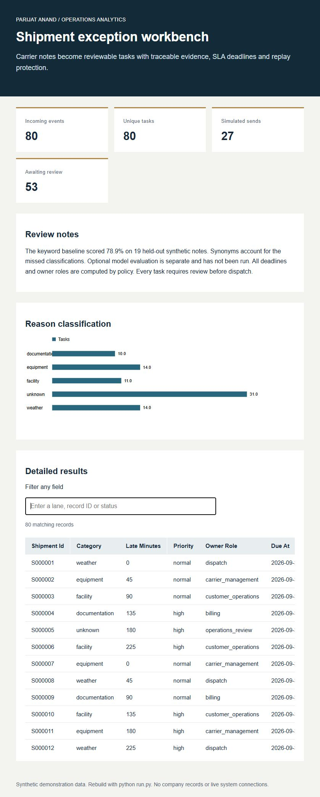
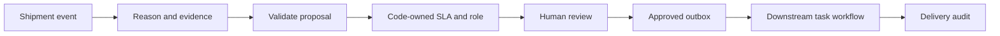

# Shipment exception workbench

Carrier updates are often short, inconsistent and difficult to turn into accountable
follow-up. This project converts a shipment event into a reviewable task with a reason,
owner role, SLA deadline and audit trail. It includes a keyword baseline and an optional
structured-output model adapter so the two approaches can be evaluated separately.



## Run it

Python 3.10 or newer. The default run is offline and requires no packages or credentials.

```bash
python -m unittest discover -s tests -v
python run.py
python evaluate.py
```

Open `build/index.html`. Inspect `build/tasks.json` and
`build/evaluation-baseline.json` for the underlying evidence. A downloadable
[sample report](sample/index.html) is also included.

## Observed results

The demonstration receives 80 events twice, retains 80 unique tasks, sends 27 through
a simulated dispatcher and leaves 53 awaiting review. Each simulated approved task
first encounters a retryable failure. A successful delivery is not repeated.

On 19 held-out synthetic notes, the keyword baseline has 78.9% overall accuracy and
52.6% coverage. Its answered classifications are correct in this small set; four
synonym cases are missed. The complete failures are retained in the evaluation file.
This is a small authored fixture, not an independent production benchmark.

## Where AI fits

The model only proposes a reason and a short verbatim evidence excerpt. Application
code assigns the owner and deadline. Schema checks reject extra fields and evidence
that does not appear in the note. These checks do not establish semantic correctness,
so human review remains required.

To evaluate the optional OpenAI adapter, set `OPENAI_API_KEY` and `OPENAI_MODEL` in
your shell, then run `python evaluate.py --live`. This makes paid API calls for the
synthetic evaluation notes. Credentials are never stored in the repository.
The live adapter is contract-tested with mocked responses; live model scores have
not been measured. Model errors are recorded as errors, not silently counted as
successful baseline predictions.



## Reliability choices

- Stable event keys prevent duplicate tasks on replay.
- Conflicting replays fail instead of overwriting a reviewed task.
- Unapproved tasks cannot reach the dispatcher.
- Known pre-send failures have bounded retries.
- Timeouts and unknown delivery outcomes enter reconciliation, not blind retries.
- A crash after claiming a task leaves it in `sending` for operator investigation.

See [workflow operations](docs/operations.md), [integration contracts](integrations/README.md),
[evaluation fixtures](fixtures/evaluation.json) and [development workflow](docs/development.md).

## Scope

The local workflow and simulation are executable. Power Automate and Zoho Projects
are supplied as field mappings, payload contracts and a deployment procedure.
They have not been connected to a live tenant. This is a single-worker SQLite
demonstrator, not a multi-tenant task service. It contains no employer data or code.
